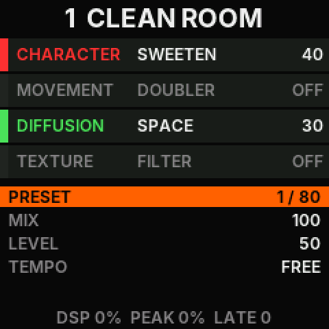
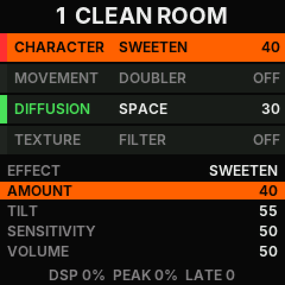
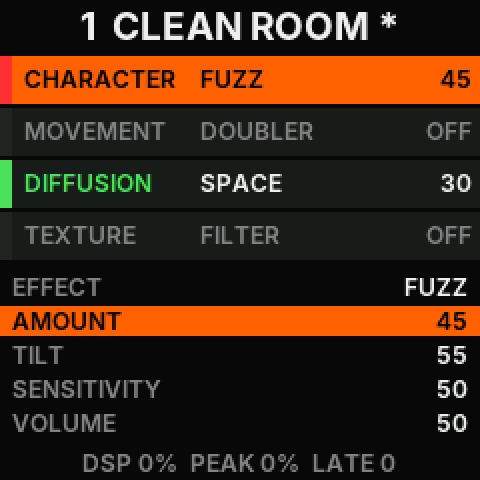
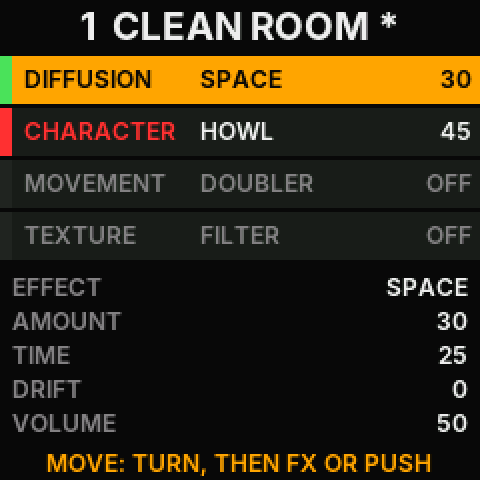
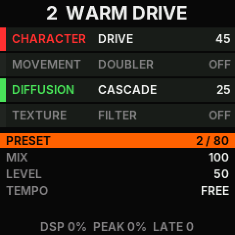
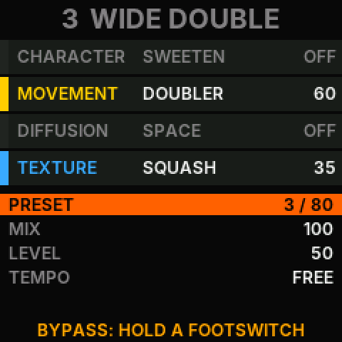
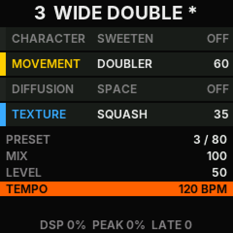
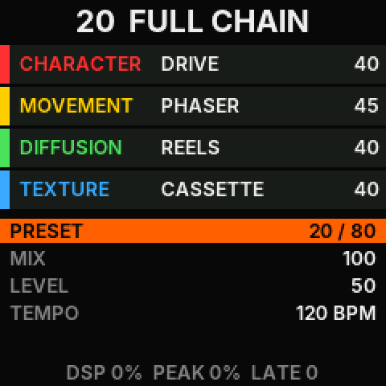
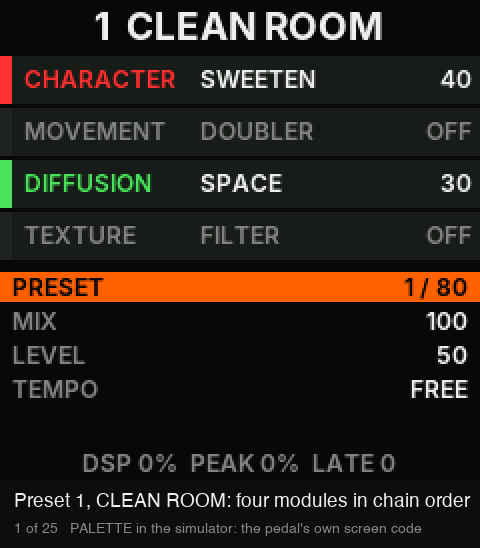

# PALETTE: a four-module stereo instrument

PALETTE (`firmware/apps/palette`) is an alternative firmware on the base firmware
([BASE-FIRMWARE.md](BASE-FIRMWARE.md), [ALT-FIRMWARE.md](ALT-FIRMWARE.md)). It is a product of its own, not a version
of OpenPocket. The public installer never offers it.

Its reference is the Hologram Chroma Console: twenty stereo effects in four modules that can be put in any order. The
module and effect names are the plain words of that instrument. Every algorithm here is written from the manual's
description of behaviour and from textbook structures. No code, table, or constant comes from the reference product,
and nobody compared the sound with a real unit.

This document is the design note for the first version and the plan for the next ones.
[PALETTE-REPORT.md](PALETTE-REPORT.md) has the measured levels and costs, and the checks that still need a pedal.
Nothing here has run on a pedal yet.

## 1. What this version has, and what comes next

| In this version | Next |
| --- | --- |
| The product on the base: descriptor, identity, install guard, recovery | A web editor page (the requests it needs exist: section 7) |
| The engine: four modules in series, one of five effects each, any order, stereo throughout | Voicing every effect by ear with a pedal (the levels here are measured, not judged) |
| All twenty effects | Capture (the looper and sustainer) and Gesture (recorded knob movements) |
| The sixteen knob functions, each module's effect, on and off, the order, the filter style, a tempo | Dual bypass, bypass with trails, calibration levels |
| Tap tempo, MIDI clock, and the tempo-synced effects | The button lights, the tuner |
| 80 presets in the app's own store, 20 factory sounds | An expression control over MIDI |
| The pedal's controls and screen, the MIDI map of the reference, its own editor requests | Running a mono part of the chain once (a saving, the report's section 3) |
| | A glide for every knob: a quick turn, or a value that jumps over MIDI, can tick where the knob sets a gain or a filter |
| Host tests, the simulator with sound, the render report | |

## 2. The data model

A **sound** is 28 bytes (`pl_sound_t`, `engine.h`). It is what a preset stores, what MIDI and the editor change, and
what the engine is set from.

| Field | Content |
| --- | --- |
| `knob[16]` | The sixteen knob functions, each 0 to 100, in the order of the reference's Control Changes 64 to 79 |
| `fx[4]` | The effect of each module, 0 to 4 |
| `order[4]` | The serial order: a permutation of the four modules |
| `on` | Bit `m` is set when module `m` is on. A module that is off keeps its effect |
| `style` | The Filter effect's style: tilt, low-pass, high-pass |
| `tempo` | 0 for free time, or 30 to 300 beats a minute |

| Module | Effects 0 to 4 | Its knobs |
| --- | --- | --- |
| Character | Drive, Sweeten, Fuzz, Howl, Swell | AMOUNT, TILT, SENSITIVITY, EFFECT VOL |
| Movement | Doubler, Vibrato, Phaser, Tremolo, Pitch | AMOUNT, RATE, DRIFT, EFFECT VOL |
| Diffusion | Cascade, Reels, Space, Collage, Reverse | AMOUNT, TIME, DRIFT, EFFECT VOL (the wet part only) |
| Texture | Filter, Squash, Cassette, Broken, Interference | AMOUNT, EFFECT VOL |

MIX and OUTPUT LEVEL belong to the whole sound. A knob at 50 is neutral for TILT, SENSITIVITY, OUTPUT LEVEL, and
EFFECT VOL.

## 3. The engine

`engine.c` has three parts with one job each.

- `pl_coefs(sound, quarter_ms, bypass, &coef)` turns a sound into the numbers a block runs on. It is slow (it calls
  `powf` and `sinf`) and pure. The main loop calls it.
- `pl_commit(engine, &coef)` hands those numbers over. The app calls it with the audio interrupt held, so a block never
  sees half of a change.
- `pl_run(engine, in, out)` makes one block of 128 frames in the audio interrupt: the mono guitar in, a left and a
  right block out.

**Changes without clicks** are the engine's work, not the app's. A module holds the effect it runs and a blend
between its input and its output.

- A knob moves a little: the module takes the new numbers at the next block. Delay times, volumes, Vibrato's depth,
  and Phaser's stages glide.
- The knobs jump under a running effect (another preset whose module keeps its effect, another filter style): the
  module's blend goes to its input, the module takes the new numbers, and the blend comes back. Its memory is kept.
  A single knob set from MIDI or the editor is never treated as a jump, so a controller swept quickly does not hold
  the module at its input.
- Another effect, or a module switched off or on: the module's blend goes to its input in 5.8 ms, its memory is
  cleared, and the new effect is set. The effect then runs unheard while its input fades in and its memory fills:
  5.8 ms, 8.7 ms for Cassette, 26 ms for Pitch. Then the blend comes back. The other modules keep sounding, and so
  do their tails.
- Another order: the chain's output fades out, the order changes, and it fades in. No memory is cleared.
- Bypass: the output crossfades to the guitar. While bypassed, no module runs. On the way back each module starts
  clear.
- A preset is those cases together. A module whose effect stays the same keeps its tail.

**Memory.** A module's five effects share one buffer, because one runs at a time. Movement and Texture each have
8,192 samples of 16 bits at the full rate. Diffusion has 45,056 samples of 16 bits at half rate (2.04 s). The engine
is one struct in the app's `POOL` region. It allocates nothing at run time, and every loop in the audio path has a
fixed count.

**Stereo.** The input is mono. The engine carries two channels from its first module on. No effect puts a signal on
the right side only, and no effect inverts one side against the other, so the left output alone and the sum of both
are each a complete sound. Whether the pedal's output jack carries two channels is not known.

**Safety.** The pedal's FPU slows on denormal numbers, and silence through a filter that feeds back decays into
them. Each module's input gets a tiny alternating offset, a filter fed from 16-bit memory gets a tiny constant at
each step, and a glide that ends at zero ends there exactly. A test scans what the engine keeps for denormals through
eight seconds of silence after each effect. Every write to a delay line is clamped. The feedback of Cascade, Reels,
and Collage goes through a soft clipper, so it can oscillate without overflow. Space's lines hold a quarter of the
input's level, because they ring up to five times their input, and a test shows that they stay under the clamp at
full input. The engine's output has a soft ceiling that
starts at half of full scale, which is the loudest the guitar itself can be, and the base adds its own knee after the
MASTER volume. The base silences a NaN and resets the engine.

**Tempo.** With a tempo, RATE picks a note value for Vibrato, Phaser, and Tremolo, and TIME picks one for Cascade,
Reels, and Collage. Reverse takes its segment length from the tempo. The tempo is the preset's, a tap's, or the MIDI
clock's while a clock runs.

## 4. Controls

| Control | What it does |
| --- | --- |
| AMP, MOD, DLY, CAB | Character, Movement, Diffusion, Texture: the module's page. Pressed again: its next effect. Held: the module off and on |
| HOME | The sound's page: PRESET, MIX, OUTPUT LEVEL, TEMPO |
| The knob | The selected line's value. Turned quickly, it goes in steps of 5 |
| PUSH | The next line. Held: SAVE the sound to its slot |
| FX | MOVE: the selected module is picked up, the knob moves it along the chain, FX or PUSH drops it |
| REV | TAP: two taps or more set the tempo. Held: free time |
| The footswitches | The preset before, the preset after. Held: bypass, off and on |
| MASTER | The volume |

A footswitch changes the preset when it comes up, because a hold means bypass. The footswitches skip the slots that
hold no sound. The knob on the PRESET line reaches every slot.

## 5. The screen

The preset's number and name are at the top. Below them are four tiles in the chain's order, one a module: its name
in its colour, its effect, and its AMOUNT. A module that is off is dim. Under the tiles are the lines of the selected
page, with the selected line lit. The last line shows the load (DSP), its peak since the sound last changed (PEAK),
and the number of blocks that came late (LATE), or a note such as SAVED or BYPASS.

These pictures are the pedal's 240 x 240 screen, drawn by the app's own code in the simulator
(`node tools/op.mjs sim --app palette`, `GET /api/screen.rgb565`), with each pixel doubled. The simulator's time does
not pass inside the audio interrupt, so DSP and PEAK read 0 there.

| | | |
| --- | --- | --- |
|  Preset 1: four tiles in the chain's order, the sound's page |  AMP: Character's page, on AMOUNT |  AMP again: the next effect, FUZZ |
|  DLY, FX, the knob: Diffusion moved to the front |  The right footswitch: preset 2 |  A footswitch held: bypass |
|  REV twice: the tap sets the tempo |  Preset 20: the four modules on | |

The same controls in sequence, 24 steps, each with a caption:

## 6. Presets

The app keeps 80 slots through `base/store.h` under its own magic number. The first 20 slots have factory sounds
until they are saved over. A slot that was never saved and has no factory sound is empty. What the flash held is
checked field by field at the start, and a sound that fails the check is not loaded.

## 7. MIDI and the editor requests

The MIDI map is the reference's, so a controller set up for it works.

| Message | Meaning |
| --- | --- |
| Program Change 0 to 79 | A preset |
| Control Change 64 to 79 | The sixteen knob functions |
| Control Change 16 to 19 | A module's effect: 0 to 109 in five steps, 110 and above off |
| Control Change 103 to 106 | A module off (below 64) and on |
| Control Change 91 | Bypass (below 64) and engage |
| Control Change 84 | The filter style: low-pass, tilt, high-pass |
| Control Change 93 | A tap |
| Clock, Start, Stop | The tempo while the clock runs |

The app's own editor requests (protocol 1) are in `app.h`: STATE reads the slot and the sound, SET changes one field,
LOAD reads the load figures, and there are requests to pick a preset, to save, to rename, and to read a slot's name.
A web page needs no more than these.

## 8. Verification without a pedal

- `tests/test_palette.c` runs the engine's own code with the firmware's math library: every effect is finite, not
  silent, and bounded on loud, quiet, and silent input, at every knob's ends; an effect change, an order change, and a
  bypass make no step in the output; nothing the engine keeps decays into a denormal; a sound that fails the check is
  refused.
- `tests/test_palette_sim.mjs` drives the app in the simulator: its identity, controls, screen, MIDI map, editor
  requests, store, and safe mode.
- `tests/palette_render.c` renders each effect on a standard signal and prints the tables of the report: loudness,
  peak, and time. It can write each effect as a WAV file.
- `node tools/op.mjs sim --app palette` opens a page with the screen and the controls. Its Listen button plays a guitar
  loop through the app's own code ([SIMULATOR.md](SIMULATOR.md), "An app on the base firmware").
- [audio/README.md](audio/README.md) lists fifteen audio samples: Creative Commons guitar recordings through the
  engine on a computer and then through an amplifier simulation, each with an amp-only reference. They are not
  recordings of a pedal.
- `node tools/op.mjs all` builds the image and its packages next to OpenPocket's and STARTER's, installs the built
  package on the simulated update pedal over OpenPocket and OpenPocket back, and ends with the release pin.

## 9. Merging upstream changes

PALETTE is files of its own: `firmware/apps/palette/`, `tests/test_palette.c`, `tests/test_palette_sim.mjs`,
`tests/palette_render.c`, `tools/cyclecount.py`, and these two documents. It changes no file of the base firmware
(`firmware/base/`, `px_usb.h`, `app.ld`, `build.sh`) and none of OpenPocket's.

It adds lines to five files that upstream also edits: `README.md` (one sentence), `docs/SIMULATOR.md` (in its
section on apps, which upstream does not have), `tools/sim.mjs` (the simulator's loop, audio, and clock requests),
`tests/run_tests.sh`, and `.github/workflows/build.yml`. A conflict there is in the added lines, and upstream's side
is kept as it is ([BASE-FIRMWARE.md](BASE-FIRMWARE.md), section 14).

It also changes files that only this fork has, so they cannot conflict with upstream: the app simulator's stand-in
and page (`tests/host/base/start.h`, `tools/sim/app.html`), `tests/test_products.mjs` (its built-package check now
runs for every app), and the documents `BASE-FIRMWARE.md` and `ALT-FIRMWARE.md`.
